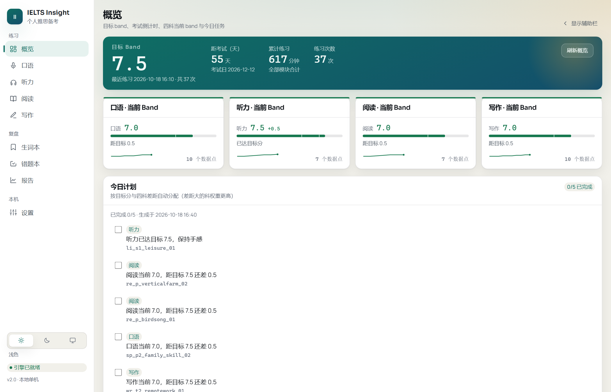
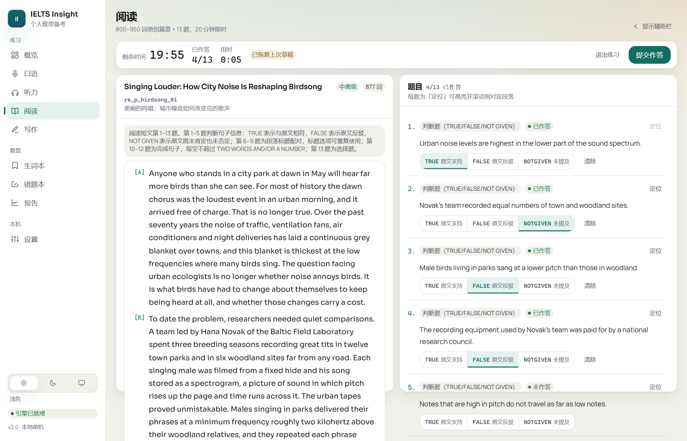
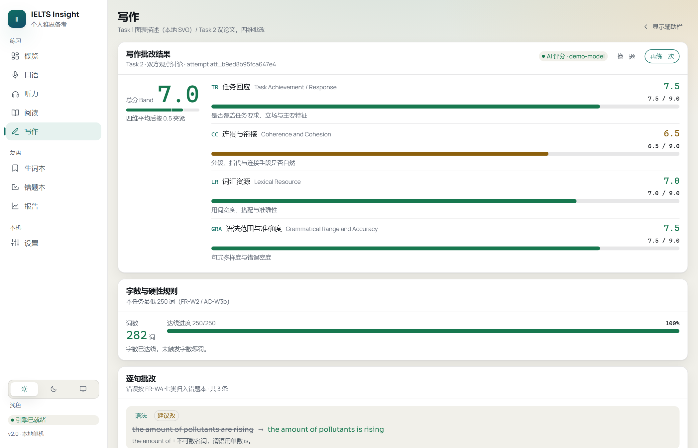
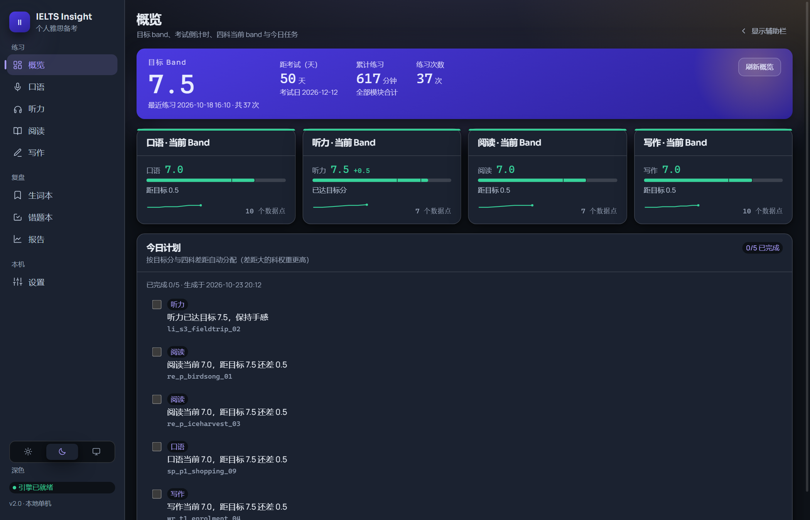
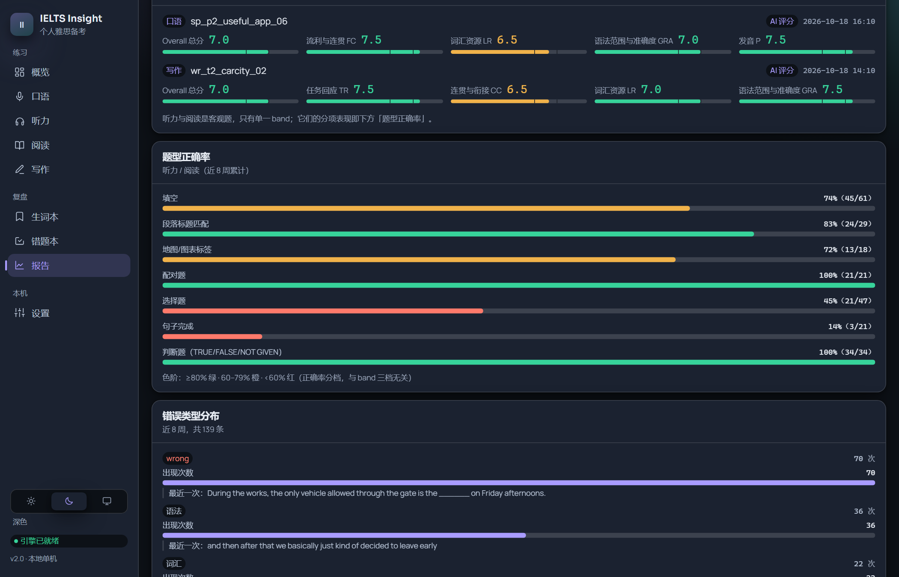
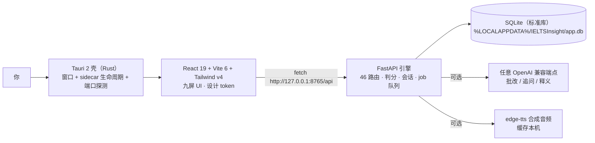

<div align="center">

# IELTS Insight

**个人雅思备考桌面应用 —— 听 · 说 · 读 · 写 四科练习 + 可配置 AI 评分**

单机本地运行：无账号、无服务器、无遥测、无云端同步。阅读、写作、口语（文本）、判分、趋势全部离线可用。




</div>

---

> **一句话**：把「剑桥真题 + 一个 AI 端点」变成一台只属于你的雅思自习机 ——
> 题目在本机、判分在本机、记录在本机，AI 只是可选的增强件。

截图中的练习记录均为**演示数据**（6 周、37 次练习），不含任何真实用户数据；题库全部为本项目原创，**不含剑桥真题或官方样题原文**。

## 目录

- [为什么做这个](#为什么做这个)
- [界面一览](#界面一览)
- [核心能力](#核心能力)
- [AI 批改为什么是异步的](#ai-批改为什么是异步的)
- [架构](#架构)
- [快速开始](#快速开始)
- [打包成 EXE](#打包成-exe)
- [题库内容](#题库内容)
- [设计与主题](#设计与主题)
- [质量门](#质量门)
- [数据位置与凭据纪律](#数据位置与凭据纪律)
- [许可](#许可)
- [已知限制](#已知限制)
- [给贡献者：先读这三个文件](#给贡献者先读这三个文件)

## 为什么做这个

市面上的雅思 App 有三件事让人难受：**订阅制 + 云端账号 + 数据不在自己手里**。而个人备考真正需要的东西很朴素：

| 痛点 | 这个应用的做法 |
| --- | --- |
| 做题要联网、要登录 | 单机 EXE，装完就能用；不填任何 AI 密钥也能做题、判分、看趋势 |
| 批改只有分数没有理由 | 写作逐句批改（错误类型 + 中文解释 + 修改建议 + 句子升级 + 范文），口语按四项评分标准给证据 |
| 不知道今天该练什么 | 今日计划按「目标分 − 当前分」自动分配权重，差距大的科排得多，达标科保底 0.25 权重保持手感 |
| 错题记了不会再看 | 错题跨练习累积（同一错误 `seen_count` 累加）、按错误类型筛选、手动标记已掌握，可导出 CSV / Anki |
| AI 分数被当成官方成绩 | 所有分数一律标注 **Band（AI 估计分）**；离线降级时界面显式挂「近似分 / 离线模板」，绝不伪装成 AI 分 |

## 界面一览

| 阅读：800–950 词原创篇章 + 13 题限时 | 写作：四维批改 + 逐句证据 + 句子升级 |
| --- | --- |
|  |  |
| **深色 · 概览**：目标 Band、倒计时、四科当前分与迷你趋势 | **深色 · 报告**：分项 Band、题型正确率、错误类型分布 |
|  |  |

阅读屏右上角的 `已恢复上次草稿` 是断点续做：中途关掉窗口，答案还在本地草稿里。

## 核心能力

| 屏 | 关键行为 |
| --- | --- |
| 概览 | 目标 Band、考试倒计时、累计时长、四科当前 Band + 迷你趋势、今日计划（按差距自动分配） |
| 口语 | Part 1 快问快答 / Part 2 题卡准备 + 计时 / Part 3 考官追问；录音或文本兜底，Whisper 转写 + 四维评分 + 发音问题词 |
| 听力 | 2 section × 10 题，0.75×–1.25× 倍速、回退 5 秒、逐句重听（时间轴按真实音频时长锚定）、断网可「看原文精读」 |
| 阅读 | 800–950 词原创篇章 + 13 题，20 分钟限时、段落定位高亮、选词查释义、TFNG / 配对 / 完成句子 / 选择 |
| 写作 | Task 1 由 `chart.data` 本地 SVG 渲染（饼 / 线 / 柱 / 表 / 动态对比），Task 2 议论文；四维批改 + 证据引用 + 升级表达 + 范文 |
| 生词本 / 错题本 | 跨模块积累、话题标签、按错误类型筛选、CSV / Anki 导出 |
| 报告 | Band 趋势（0–9 固定轴）、分项 Band、题型正确率、错误类型分布、近 8 周练习时长热力 |
| 设置 | 目标分、考试日期、口音与音色语速、录音设备与增益、AI 端点、主题 |

客观题（听力 / 阅读）判分是**纯本地规则**：答案归一化（拼写变体、单词限制、题号与大小写）+ 官方 raw→Band 换算表，不依赖任何网络。

## AI 批改为什么是异步的

实测某个 OpenAI 兼容端点批改一篇 Task 2 要 **133 秒**。同步等待等于让用户盯着转圈以为程序死了，所以批改被做成**可重连的后台任务**：

1. 「提交批改」/「开始评分」调 `POST /writing/attempts/async`（#21b）或 `POST /speaking/sessions/{id}/assess/async`（#11b），立刻拿 `job_id`；
2. 前端进入骨架屏，但**允许你离开这一屏去做别的科目**。轮询由模块级 store 统一持有（2.5s 一次），`job_id` 落在 `localStorage`（`ielts.grading-jobs`），刷新 webview 或重开应用能接回；
3. 完成后：你还在等 → 直接进报告；已经走了 → 选题页横幅 + 左轨导航角标提示，点了「查看报告」才算已读；
4. **不提供取消**：已经在付费的上游调用不该被静默中止；超过 15 分钟未终态则本地判失败并给出下一步；
5. 失败原样显示后端中文 `error`，草稿只在批改**成功**时清空，重试发的是同一份正文。

规则细节（去重键、任务复用、启动回收、为什么用单条守护 worker 而不是 `BackgroundTasks`）见
[spec-contracts.md §10.6](docs/specs/ielts/spec-contracts.md)。同步端点 `#21` / `#11` 保留不动，脚本与旧用例不翻案。

**不填 key 也能用**：所有 AI 评分改走本地近似，返回 `ai_used:false` + `degraded_reason`，界面挂「降级」标记 —— 这是刻意的：宁可给一个诚实的近似分，也不给一个看起来精确的假分。

## 架构



三层各自能被单独替换，边界只有一份契约文件：

- **壳不写业务**：`main.rs` 只管启动 sidecar、探测 8765 端口、失败时给出中文提示；
- **前端不依赖 Tauri**：`src/` 里没有一处 `@tauri-apps/api`，所以**不开桌面窗口、直接在浏览器打开 `http://localhost:5173` 就能完整调试**（含麦克风录音）；
- **后端不碰 UI**：路由只出 JSON 信封 `{data,total?}`，错误只出 `{detail,code}` 且 `detail` 是中文。

| 层 | 技术 | 为什么 |
| --- | --- | --- |
| 壳 | Tauri 2 + Rust | 桌面壳只有 11 MB（不塞一个 Chromium 进去）；安装包整体 348 MB，体积几乎全在 sidecar |
| 前端 | React 19 + TypeScript + Vite 6 + Tailwind v4 + vitest/jsdom/msw | 无路由库（九屏用状态机），契约测试用 msw 打真端点形状 |
| 引擎 | FastAPI + `sqlite3`（标准库）+ PyInstaller | 无 ORM、无外部数据库；冻结成单文件 EXE 就能带着走 |
| 内容 | 原创题库 JSON + `edge-tts` | 音频本机合成缓存，避开真题版权与素材分发 |

## 快速开始

前置：Windows 10/11、**Python 3.13**（本仓库在 3.13.14 下验证，`openai-whisper` 需要它）、Node 22/24。打包额外需要 Rust。

```powershell
# 1) 后端虚拟环境
cd backend
py -3.13 -m venv venv
.\venv\Scripts\python.exe -m pip install --upgrade pip
.\venv\Scripts\python.exe -m pip install -r requirements.txt -r requirements-dev.txt

# 2) 配置（可选：要用 AI 批改才必填）
cd ..
copy .env.example backend\.env       # 填 OPENAI_API_KEY / OPENAI_BASE_URL / OPENAI_MODEL

# 3) 前端
cd frontend ; npm install

# 4) 开发（回到仓库根目录）
powershell -ExecutionPolicy Bypass -File scripts\dev.ps1
```

`dev.ps1` 用 venv python 起 `uvicorn --reload`（127.0.0.1:8765）并起 vite，Ctrl+C 时一并停掉后端进程树。
桌面窗口调试：`cd frontend ; npm run tauri dev`。

只想跑一遍质量门（不启服务）：

```powershell
bash scripts/check.sh          # tsc → vitest → pytest，第一个失败即非零退出
bash scripts/check.sh --quick  # 跳过后端 pytest
```

## 打包成 EXE

```powershell
cd backend ; .\venv\Scripts\python.exe -m pip install pyinstaller
powershell -ExecutionPolicy Bypass -File scripts\build.ps1
```

`build.ps1` 四步：① 只结束**本仓库路径下**遗留的 backend 进程（不宽泛 `taskkill`，不碰同名外部进程）
② PyInstaller → `backend\dist\backend.exe`（`--add-data` 带上 `app/data/**` 题库词典与 `app/db/schema.sql`）
③ 复制成 sidecar 命名 `frontend\src-tauri\binaries\backend-x86_64-pc-windows-msvc.exe`
④ `npm run build` → `npm run tauri build`（NSIS）。

产物：`frontend\src-tauri\target\release\bundle\nsis\IELTS Insight_2.0.0_x64-setup.exe`（348 MB，
其中 `backend.exe` 单文件 347 MB —— `openai-whisper` 连带 `torch` 被 `collect_all` 收了进来）。
想砍体积的出路是把 STT 换成不依赖 `torch` 的实现（如 CTranslate2 系）或改 `--onedir`，两者都属于未擅自改的取舍。

> ⚠️ **不要**直接 `cargo build --release`：不带 `custom-protocol` feature 会得到一个卡在 `ERR_CONNECTION_REFUSED` 的空窗口。始终用 `npm run tauri build`。
> 版本自检：`powershell -ExecutionPolicy Bypass -File scripts\version-check.ps1`（`tauri.conf.json` / `Cargo.toml` / `package.json` 三处须一致）。

## 题库内容

`backend/app/data/ielts/` 共 **36 套**：speaking 18 / listening 4 / reading 4 / writing 10，按 `<module>/*.json` 装载（`manifest.json` 不是题集）。36 套的 `source` 字段**全部记录为 `hand`**（本项目自写），**不含剑桥真题、官方样题或教材原文**（CONSTITUTION §2 的硬约束）；听力音频由 edge-tts 合成后缓存本机。

内容 schema 与 `set_id` 命名规则见 [spec-contracts.md §10.1](docs/specs/ielts/spec-contracts.md)，机器化校验：

```powershell
cd backend ; .\venv\Scripts\python.exe tools\validate_ielts_data.py
```

## 设计与主题

两层令牌（[src/index.css](frontend/src/index.css)）：语义名（`--paper` / `--ink-muted` / `--accent` / `--rule` / `--band-*` / `--heat-*` / `--chart-*`）在两套主题里**不变**，只有取值分两套 —— 浅色「晨读」（暖纸面 + 墨绿青 + 琥珀）与深色「夜航」（石墨 + 紫青 + 琥珀）。`useTheme` 解析「浅色 / 深色 / 跟随系统」后只写 `html[data-theme]`，因此切换主题不需要逐屏改色，**组件内出现任何字面色值都算违规**（已核对：全仓 `.tsx` 无 hex / rgba 字面量，规则见 [spec-contracts.md §8](docs/specs/ielts/spec-contracts.md)）。

对比度是**取值规则**而不是事后调优：任何当文字用的 token 与其最坏落点（正文小字落在 `--paper-sunken` 上，不是白卡上）必须 ≥ 4.5:1。图表网格线、色阶、骨架屏各有专用 token，不许拿分隔线凑。逐条数值见 [spec-contracts.md §8](docs/specs/ielts/spec-contracts.md)。

显示字体 Sora / Manrope 本地打包（`frontend/src/assets/fonts/`，均 SIL OFL 1.1，取自 Google Fonts），配合 CSP `font-src 'self' data:` 保证离线可用；中文走系统字体不额外下载。

## 质量门

| 门 | 当前状态 |
| --- | --- |
| `npx tsc --noEmit` | 无错误 |
| 前端 `cd frontend ; npm test` | **31 个文件 / 328 个用例全通过**（vitest + jsdom + msw 契约测试） |
| 后端 `cd backend ; .\venv\Scripts\python.exe -m pytest` | **297 个用例全通过**（约 6s） |

后端测试通过 `IELTS_DB_PATH` / `IELTS_TTS_CACHE_DIR` / `IELTS_ONLINE` 指向临时目录与离线模式，**绝不写**真实本地库（CONSTITUTION §6）。真实 LLM 质量测试标 `@pytest.mark.integration`，默认跳过，需 `RUN_INTEGRATION=1`。`pyinstaller_entry.py` 只是打包入口，测试进程不经过它。

## 数据位置与凭据纪律

- 数据库：`%LOCALAPPDATA%\IELTSInsight\app.db`（`IELTS_DB_PATH` 覆盖）。
- TTS 缓存：`%LOCALAPPDATA%\IELTSInsight\cache\tts\`（`IELTS_TTS_CACHE_DIR` 覆盖）。
- 不放 exe 同目录也不放相对 CWD：装进 `Program Files` 后不可写，且 PyInstaller 的相对路径会随启动目录漂移 —— 这是旧版本的坑，已修。
- 升级首启若检测到旧版 `app.db`（剧本跟读数据），先复制归档为同目录 `app.pre-ielts.bak` 再按新 schema 建表。想留旧数据请在归档前自行拷贝。

`OPENAI_API_KEY` / `base_url` / `model` 只从 `backend\.env` 读取（`.env` 已被忽略，模板见 `.env.example`），可被设置页覆盖后存进本机 `settings` 表。这三项**绝不写日志**、**绝不出现在任何接口返回值或错误信息里**：`GET /settings` 只回 `ai_key_present`，`store.py` 的 `PRIVATE_SETTING_KEYS` 负责剔除，key 输入框是 `type=password` 不回显（CONSTITUTION §3 / AC-C2）。

麦克风：Tauri 没有「麦克风」权限项，能否录音由 **WebView2（Chromium）媒体权限 + Windows 隐私设置**决定。处理方式（`main.rs` 设 `WEBVIEW2_ADDITIONAL_BROWSER_ARGUMENTS=--use-fake-ui-for-media-stream`）、失败提示与回退方案见 [mic-on-windows.md](docs/specs/ielts/mic-on-windows.md)。

## 许可

**代码 = MIT**（[LICENSE](LICENSE)）：随便用、改、商用，保留版权声明即可。
**题库与截图 = CC BY-NC 4.0**（[LICENSE-CONTENT.md](LICENSE-CONTENT.md)）：自用、给学生、改编都行，不许打包进付费产品。
分开的理由很实际 —— 这个项目里最值钱、最容易被白嫖的是 36 套原创题目，不是代码；一刀切 MIT 等于把内容也送人。

字体（Sora / Manrope）为 SIL OFL 1.1，`edge-tts`（LGPL-3.0）、`PyInstaller`（GPL-2.0 + booting exception）、`openai-whisper`（MIT）、`torch`（BSD-3-Clause）各自保留原许可；逐项见 [LICENSE-CONTENT.md §2](LICENSE-CONTENT.md)。

## 已知限制

诚实清单，按影响排序：

- **NSIS 安装器未在本机执行安装**（会写入用户系统，需明确同意），因此打包版 GUI 窗口内的 WebView2 麦克风采集**也未实测**。
- 冻结包已实跑验证（临时库启动 EXE，`/health` 回 `2.0.0`、四科题量齐全、能判分、断网走可见降级）；但 spec 的 `excludes`（tkinter/PIL/matplotlib）基于全仓零 import 判定，未在产物上逐个验证。
- 单文件 EXE 首启解包约 20–30s 才绑定端口，期间前端显示「正在启动本地引擎」（AC-G1）。要更快可改 `--onedir`（未擅自改）。
- CSP 的 `connect-src` 目前含 `https://*` 以放行任意兼容端点，`media-src` 额外放行了 `127.0.0.1:8765`。收紧方法见 [spec-contracts.md §11](docs/specs/ielts/spec-contracts.md)（AI 调用实际发生在后端进程，webview CSP 并不约束后端出网）。
- 应用给的是 **AI 估计分**，不是官方成绩；口语发音分依赖 Whisper 转写质量（转写置信度 <0.5 时界面会提示重录或改用文本）。
- 题库只有 36 套（内容生产是本项目最慢的一环），刷完需要自己扩；扩题只需往 `backend/app/data/ielts/<module>/` 放 JSON 并通过校验脚本。
- 两处**首次**需要联网（之后缓存本机）：听力音频由 edge-tts 现合成（TTS 缓存目录不随包分发），口语转写用的 whisper `base.pt`（约 145 MB）首次加载时从官方源下载。在那之前对应功能会走可见降级（听力「看原文精读」、口语键盘输入）。
- 前端全量测试在机器高负载下偶发 `findBy*` 超时红灯（jsdom + msw 回调被挤），根因是 `src/test/setup.ts` 未挂全局 RTL cleanup；已把 `asyncUtilTimeout` 放宽到 4s，未做全局 cleanup（9 个测试文件各自显式调用了 `cleanup()`，需逐个核对再挂全局）。
- `backend/app/data/dictionary.json`（392 词条：音标 + 中文释义 + 难度）的**来源未在本仓库留档**，无法确认是自写还是从公开词典整理而来，因此 [LICENSE-CONTENT.md §3](LICENSE-CONTENT.md) 未对它声明任何版权主张；要复用到发布包请先自行核对原始许可。

## 给贡献者：先读这三个文件

| 文件 | 作用 |
| --- | --- |
| [docs/specs/CONSTITUTION.md](docs/specs/CONSTITUTION.md) | 不可违反的产品宪法（离线优先、无遥测、不抄真题、凭据不外泄） |
| [docs/specs/ielts/spec-contracts.md](docs/specs/ielts/spec-contracts.md) | 前后端唯一契约真源：46 个路由、响应信封、错误码、内容 schema、设计 token |
| [docs/specs/ielts/spec-product.md](docs/specs/ielts/spec-product.md) | 逐条验收标准（AC-xx），改行为先改这里 |

本项目按 **SDD + TDD** 推进：契约先行 → 测试先红 → 实现转绿 → `scripts/check.sh` 三道门。
[docs/specs/ielts/tasks.md](docs/specs/ielts/tasks.md) 是任务分解，[test-plan.md](docs/specs/ielts/test-plan.md) 是测试策略。

### 目录

```
backend/app/         api/（46 路由） · services/（评分·会话·题库·job 队列·TTS/STT） · db/（sqlite） · prompts/ · data/ielts/（题库）
frontend/src/        features/（四科 + 报告/设置/复盘/共享） · components/ui/（设计系统） · hooks/ · services/api.ts · types/ielts.ts · test/（msw）
frontend/src-tauri/  main.rs（sidecar 生命周期 + 端口探测） · tauri.conf.json · capabilities/
docs/specs/          CONSTITUTION.md · ielts/{spec-product, spec-contracts, tasks, test-plan, content-notes, mic-on-windows}.md
docs/plans/          历史方案（v1 与 TDD 计划），只作留档，不代表当前实现
scripts/             dev.ps1 · build.ps1 · version-check.ps1 · check.sh
```
